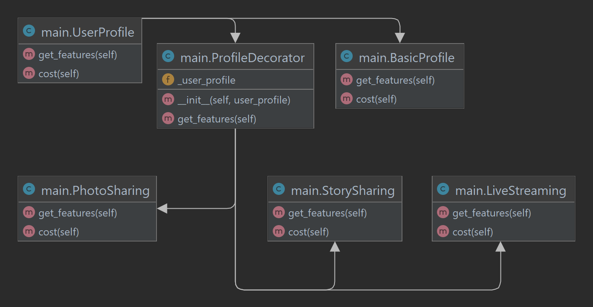

# Decorator Pattern: Theory and Application in Python

This project demonstrates the **Decorator Pattern** through a simple Python example based on social network user profiles. The main idea is to start with a basic profile and dynamically add extra features such as photo sharing, story sharing, and live streaming without changing the original class.

The repository combines both the **theoretical side** of the pattern and a **practical implementation**, which makes it useful for learning object-oriented design and understanding how structural design patterns are applied in real software scenarios.

## Project Goal

The goal of this project is to explain and demonstrate how the Decorator Pattern works in Python.

Instead of creating many subclasses for every possible combination of features, the project uses decorators to attach new behavior to an object dynamically. This keeps the design more flexible and avoids unnecessary complexity in the class hierarchy.

## What The Decorator Pattern Solves

The Decorator Pattern is useful when:

- you want to add responsibilities to objects at runtime
- inheritance would create too many subclasses
- you want to keep the original class unchanged
- you want to follow the Open/Closed Principle

In this example, a user profile starts with basic functionality and can then be extended step by step with additional features.

## Project Structure

This repository includes:

- `decorator.py` - Python implementation of the Decorator Pattern
- `main_diagram.png` - UML-style class diagram of the pattern structure
- `Неозаглавена диаграма.drawio` - editable diagram source
- `README.md` - project explanation and usage guide

## Concept Used In This Example

The project models a simplified social network profile system.

There is:

- a base abstract class for user profiles
- a basic concrete profile with default features
- an abstract decorator that wraps a profile
- several concrete decorators that add extra functionality and cost

The additional features in this example are:

- `PhotoSharing`
- `StorySharing`
- `LiveStreaming`

Each decorator adds:

- one more feature to the profile description
- an additional cost to the profile

## Class Roles

### 1. Component

`UserProfile` is the abstract component.  
It defines the common interface for all profile objects:

- `get_features()`
- `cost()`

### 2. Concrete Component

`BasicProfile` is the concrete component.  
It provides the default behavior:

- basic social features such as text posts, comments, and likes
- base cost of `0`

### 3. Decorator Base Class

`ProfileDecorator` is the abstract decorator.  
It keeps a reference to another `UserProfile` object and acts as the wrapper layer.

### 4. Concrete Decorators

The project includes three concrete decorators:

- `PhotoSharing`
- `StorySharing`
- `LiveStreaming`

Each one extends the wrapped profile without modifying the original implementation.

## Example Of How It Works

The flow is straightforward:

1. Create a `BasicProfile`
2. Wrap it with one decorator
3. Wrap the result with another decorator if needed
4. Read the final features and total cost

For example:

```python
basic_profile = BasicProfile()
full_profile = LiveStreaming(StorySharing(PhotoSharing(basic_profile)))
```

This produces one object with combined behavior, while the base class remains unchanged.

## Example Output

```text
Basic Profile Features: Text Posts, Comments, Likes - Cost: $0
Basic Profile Features: Text Posts, Comments, Likes, Photo Sharing - Cost: $5
Basic Profile Features: Text Posts, Comments, Likes, Photo Sharing, Story Sharing - Cost: $8
Basic Profile Features: Text Posts, Comments, Likes, Photo Sharing, Story Sharing, Live Streaming - Cost: $18
```

## UML Diagram

The repository also includes a diagram that visualizes the structure of the Decorator Pattern in this implementation:



## Why This Pattern Is Useful

The Decorator Pattern offers several advantages:

- **Flexibility** - behavior can be added dynamically
- **Extensibility** - new features can be introduced as separate decorators
- **Better design separation** - each added responsibility stays isolated
- **Reduced subclass explosion** - you avoid creating a separate class for every feature combination

## Trade-Offs

Like any design pattern, it also has trade-offs:

- too many decorators can make object composition harder to follow
- debugging can become more difficult when many layers are stacked
- the pattern can be overused in simple situations where direct implementation would be clearer

## How To Run

Make sure Python is installed, then run:

```bash
python decorator.py
```

The script will create several profile combinations and print their features and costs in the terminal.

## Educational Value

This project is especially useful for:

- students learning object-oriented programming
- understanding structural design patterns in practice
- seeing how composition can replace inheritance in certain scenarios
- building stronger theoretical foundations for software architecture and clean code design

## References

- Gamma, E., Helm, R., Johnson, R., & Vlissides, R. (1994). *Design Patterns: Elements of Reusable Object-Oriented Software*
- Refactoring.Guru - [Decorator Pattern](https://refactoring.guru/design-patterns/decorator)
- GeeksforGeeks - [Decorator Design Pattern](https://www.geeksforgeeks.org/decorator-design-pattern-in-java-with-example/)
- Baeldung - [The Decorator Pattern](https://www.baeldung.com/java-decorator-pattern)

## Author

**Yumer Mestan**  
GitHub: [omer-mestan](https://github.com/omer-mestan)
